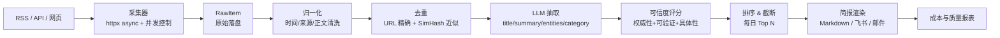

# Day 10 · 里程碑 M1：智能资讯简报 v2

> W2 · 周五 ｜ 5h ｜ 产出 `code/week02/m1_brief/` ｜ [Day 09](day-09.md) ｜ **本周里程碑**

**今日目标**
- 把"脚本式晨报"升级为**有契约、可评估、可回放**的处理流水线
- 跑通端到端：多信源采集 → 归一化 → 去重 → 结构化抽取 → 可信度排序 → 摘要 → 推送
- 留下四份可用于面试的材料：架构图、失败率数据、成本报表、一个 badcase 复盘

**验收**：`python -m week02.m1_brief.pipeline --mock` 离线跑通全链路并输出 markdown 简报；
接真实信源时 `--limit 20` 可在 3 分钟内产出。

---

## 上午 09:00–11:30 · 设计

### 1. 为什么叫"流水线"而不是"脚本"

| 脚本思维 | 流水线思维 |
| --- | --- |
| 一把梭，任何一步挂了全挂 | 每一步独立可重试、失败可降级 |
| 数据是 dict，字段随手加 | 数据有 Pydantic 契约，字段变更可控 |
| 结果好坏靠肉眼看 | 有指标：抽取成功率、去重率、平均成本 |
| 改 prompt 就全量重跑 | 原始数据落盘，可回放、可对比 |

这个思维转变本身就是 AI 应用工程师与"会调 API 的前端"的差距。

### 2. 架构



### 3. 契约先行：数据模型

```python
class RawItem(BaseModel):
    source: str
    url: str
    title: str
    content: str
    published_at: datetime | None = None
    fetched_at: datetime

class BriefItem(BaseModel):
    id: str                  # 稳定 id（url 的 hash），保证幂等
    title: str
    summary: str
    category: Literal["融资", "产品", "政策", "技术", "其他"]
    entities: list[str]
    credibility: int         # 0-100
    score: float             # 排序分 = credibility * 权重 + 时效
    source: str
    url: str
    published_at: datetime | None
```

**稳定 id** 是幂等的关键：同一条资讯重复采集，入库不会重复，也不会重复计费。

### 4. 去重的两层

1. **精确去重**：URL 归一化（去 utm 参数、去锚点）后 hash 比对。
2. **近似去重**：同一事件被十家媒体转载，正文不同但语义相同。用 SimHash / MinHash 做指纹，海明距离 ≤ 3 视为重复；
   或用 embedding 余弦 > 0.92。前者快且便宜，后者准但贵。

SimHash 是一种不用调 API 的局部敏感哈希：把正文按特征词加权压成一个 64 位指纹，两篇稿子越像两个指纹的**海明距离**（不同的二进制位数）越小，≤ 3 基本可判同一事件，10 万条也能秒级跑完。embedding 是把文本映射成向量、用余弦比相似度（Day 11 详讲，更准但按量计费），所以先用 SimHash 粗筛，只把可疑的对送进去复核。

工程取舍：**先用 SimHash 粗筛，冲突的再上 embedding**。这就是"分层过滤"的通用思路。

落到下午的任务里：在任务 2（抽取）与任务 3（排序）之间补一步「任务 2.5 · 去重（30 min）」：`dedup(items) -> (kept, dup_report)`，报表里的 `after_dedup` 就来自它的返回值。

### 5. 可信度评分：可解释 > 精确

不要问模型"这条新闻可信吗"，要让它按维度打分：

```text
credibility 评分（0-100）：
- 信源权威性（40）：官方公告 40 / 权威媒体 30 / 垂直媒体 20 / 自媒体 10
- 信息可验证性（30）：有具体数字、时间、可查证主体各 10
- 内容具体性（30）：笼统表述 10 / 有细节 20 / 有数据与引述 30
先写 analysis 说明每项得分依据，再给总分。
```

好处：评分可追溯、可校准、可回归测试。这也是 Day 31 建评估集的雏形。

### 6. 成本控制

- 抽取阶段只发**正文前 2000 字**（长文后面信息密度低）
- 批量去重后再调 LLM（先便宜后贵）
- 同一 URL 24 小时内不重复抽取（缓存）
- 每天跑完输出成本报表：`条数 × 平均 token × 单价`

---

## 下午 14:00–16:30 · 实战

### 任务 1 · 采集器（50 min）

```python
async def fetch_rss(url: str, client: httpx.AsyncClient) -> list[RawItem]:
    r = await client.get(url, timeout=15, follow_redirects=True)
    r.raise_for_status()
    feed = feedparser.parse(r.text)
    return [
        RawItem(source=feed.feed.get("title", url), url=e.link, title=e.title,
                content=clean_html(e.get("summary", "")),
                published_at=parse_time(e.get("published")),
                fetched_at=datetime.now(timezone.utc))
        for e in feed.entries
    ]
```

没有 RSS 源也不要卡住：`--mock` 模式读 `data/mock_news.json`，先把下游全部打通。
**先让链路通，再换数据源**——这是所有数据 pipeline 的正确顺序。

### 任务 2 · 抽取器（60 min）

复用 Day 08 的 v2 模板，加两件事：
- 失败隔离：单条抽取失败不中断整批，记为 `failed_items`
- 结果缓存：`cache/extract/{id}.json`，命中直接读

```python
async def extract_batch(items: list[RawItem], concurrency: int = 5) -> tuple[list[BriefItem], list[dict]]:
    sem = asyncio.Semaphore(concurrency)
    ok, failed = [], []
    async def one(it: RawItem):
        async with sem:
            try:
                ok.append(await extract_one(it))
            except Exception as e:
                failed.append({"id": it.url, "error": str(e)})
    await asyncio.gather(*(one(i) for i in items))
    return ok, failed
```

`ok.append` 在协程里不是线程安全的，但 asyncio 单线程事件循环里这个写法是安全的——
面试时能讲清"为什么 asyncio 下不用加锁、什么时候要加"是加分项。

### 任务 3 · 排序与渲染（40 min）

```python
def rank(items: list[BriefItem], now: datetime) -> list[BriefItem]:
    def score(i: BriefItem) -> float:
        hours = (now - i.published_at).total_seconds() / 3600 if i.published_at else 48
        freshness = max(0.0, 1 - hours / 48)          # 48 小时线性衰减
        return i.credibility * 0.7 + freshness * 100 * 0.3
    return sorted(items, key=score, reverse=True)
```

渲染成 Markdown，保留"分类分组 + 来源 + 可信度 + 原文链接"，这就是你的日报成品。

### 任务 4 · 质量与成本报表（30 min）

```json
{
  "date": "2026-11-20",
  "sources": 5,
  "fetched": 128,
  "after_dedup": 91,
  "extracted_ok": 88,
  "failed": 3,
  "avg_credibility": 62.4,
  "tokens": {"in": 142000, "out": 21000},
  "cost_cny": 0.31,
  "duration_s": 96
}
```

写进 `output/report_YYYYMMDD.json`。**这份报表是 M1 能不能进简历的分界线**——
它证明你关心的不是"能不能跑"，而是"跑得稳不稳、贵不贵"。

---

## 代码思考（写进 `logs/day-10.md`）

1. 为什么"稳定 id"是幂等的前提？如果 id 用 `uuid4()` 会发生什么？
2. SimHash 与 embedding 去重的分界线应该定在哪（成本/准确率）？你会怎么用 100 条样本测出来？
3. 抽取失败率 3/91，你会先优化 prompt 还是先看失败的 3 条原文？判断依据是什么？
4. 48 小时线性衰减的"半衰期"拍脑袋定的，怎么用数据校准它？
5. 如果信源从 5 个扩到 50 个，架构上第一个瓶颈会出现在哪？（提示：并发、限流、去重复杂度）

## 复盘清单（本周里程碑自检）

- [ ] `--mock` 离线模式端到端可跑（CI 也能跑）
- [ ] 真实信源跑过一次，有 `report_*.json`
- [ ] 架构图（mermaid）写进 M1 的 README
- [ ] 一段 60 秒演示录屏（手机拍也行）
- [ ] 一个 badcase 复盘：错在哪一步、根因、怎么改
- [ ] commit：`M1: 智能资讯简报 v2（采集/去重/抽取/评分/渲染）`
