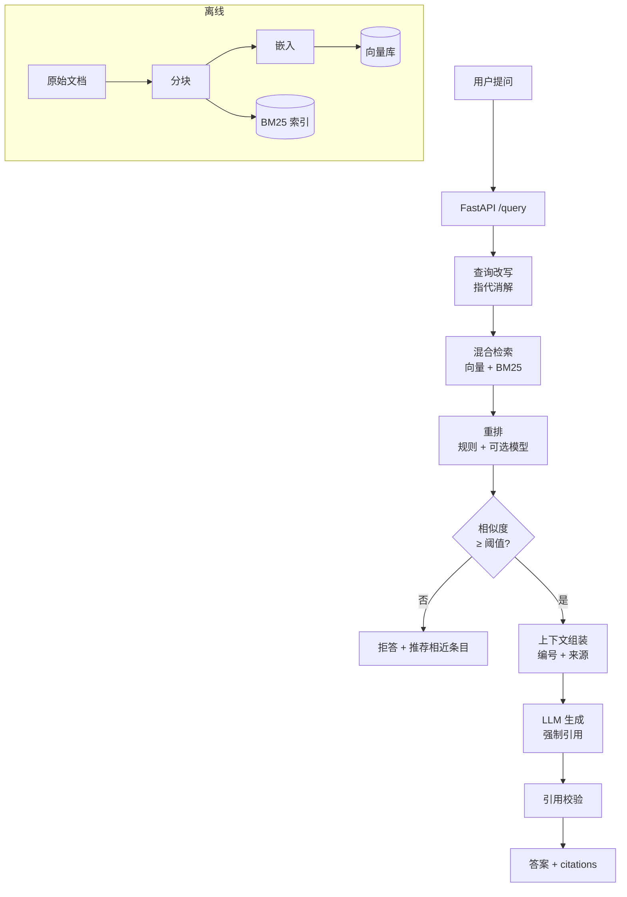

# Day 18 · M2 设计：领域知识库问答

> W4 · 周三 ｜ 5h ｜ 产出 `docs/week-04/m2-design.md` + `data/kb/`（100+ 条文档）｜ [Day 17](day-17.md) · [Day 19](day-19.md)

**今日目标**
- 完成 M2 的需求与架构设计文档（含取舍说明）
- 整理一份 100+ 条的真实领域知识库（推荐"游戏运营活动"）
- 定义验收标准：什么算"能演示"、什么算"能写进简历"

**验收**：`docs/week-04/m2-design.md` 有需求、架构图、数据字典、验收指标、风险清单；`data/kb/` 有 ≥ 100 条文档。

---

## 上午 09:00–11:30 · 设计

### 1. 为什么用"游戏运营活动"做知识库

- 你最熟，能判断"答得对不对"，这是评估的前提
- 有真实业务语气（公告、FAQ、规则），不是教科书文本
- 天然有"跨文档冲突"（新旧活动规则），可以讲深度故事
- 面试时你能说清每个 badcase 的业务背景

**没有比"你懂的领域"更好的 RAG 数据集。** 别用维基百科。

### 2. 需求定义（先写清楚再动手）

```text
用户：运营同学 / 客服同学
场景：查活动规则、奖励发放、参与条件、异常处理
输入：自然语言问题（可能口语化、可能带专名）
输出：答案 + 引用原文 + 来源文件
约束：
  - 回答必须基于知识库，不许编造
  - 检索不到时明确说"没有找到"，并给出可能的相关条目
  - 单次响应 ≤ 3 秒（流式首字 ≤ 1 秒）
  - 每条回答可点回原文
非目标（明确不做）：
  - 不做多轮复杂推理（V1 只支持单轮 + 简单指代）
  - 不做写操作（不改活动配置）
```

**"非目标"比"目标"更重要**：它防止范围蔓延，也是面试时展示工程判断的点。

### 3. 架构



### 4. 数据字典（先定 schema，再灌数据）

```python
class KBDoc(BaseModel):
    doc_id: str                    # activity_2026_spring
    title: str                     # 2026 春节活动规则
    category: Literal["活动规则", "玩法说明", "FAQ", "公告", "补偿标准"]
    version: str                   # v1.2
    effective_from: date
    effective_to: date | None
    source: str                    # 原始文件路径 / URL
    content: str                   # Markdown 正文
```

**`effective_from/to` 是灵魂**：有了它，检索时可以先过滤掉过期文档，直接消灭一大类"答旧规则"的 badcase。

### 5. 数据从哪来

| 来源 | 量 | 处理 |
| --- | --- | --- |
| 历史活动公告（内部文档） | 40–60 | 去敏后转 Markdown |
| FAQ 整理 | 20–30 | 一问一答，一条一文档 |
| 玩法说明 | 10–20 | 按 `##` 分节 |
| 补偿/客诉标准 | 10 | 表格转列表 |
| 自己编的"边界用例" | 10 | 故意写含糊/冲突的条目，用于测鲁棒性 |

**数据量不是关键，覆盖度才是**：100 条覆盖 8 个主题，比 1000 条全是活动公告有价值。

### 6. 验收指标（写进设计文档）

| 指标 | 目标 | 测法 |
| --- | --- | --- |
| 检索 hit-rate@5 | ≥ 0.85 | 30 条标注问题 |
| 答案正确率 | ≥ 0.80 | 人工二分类 |
| 引用有效率 | ≥ 0.95 | 引用编号是否指向真实存在的块 |
| 拒答准确率（无答案问题） | ≥ 0.80 | 20 条库里没有的问题 |
| P95 延迟 | ≤ 3s | 压测 100 次 |

---

## 下午 14:00–16:30 · 实战

### 任务 1 · 写设计文档（60 min）

按上面的结构写 `docs/week-04/m2-design.md`，必须包含：
- 需求与非目标
- 架构图（mermaid）
- 数据字典
- 验收指标
- 风险清单（至少 5 条，如：旧文档污染、专名分词差、上下文超长、并发限流）

### 任务 2 · 整理数据（120 min）

```python
# 统一转换脚本：把各种来源转成 KBDoc 的 JSONL
def normalize(raw: dict) -> KBDoc:
    return KBDoc(
        doc_id=slugify(raw["title"]),
        title=raw["title"].strip(),
        category=raw["category"],
        version=raw.get("version", "v1.0"),
        effective_from=parse_date(raw["effective_from"]),
        effective_to=parse_date(raw["effective_to"]) if raw.get("effective_to") else None,
        source=raw["source"],
        content=clean_markdown(raw["content"]),
    )
```

产出 `data/kb/docs.jsonl`，每行一条。**注意脱敏**：去掉真实用户 ID、内部链接、未公开的营收数据。

### 任务 3 · 造 30 条评测问题（40 min）

| 类型 | 数量 | 例子 |
| --- | --- | --- |
| 直接事实 | 10 | "春节活动奖励什么时候发" |
| 口语化 | 8 | "奖励咋还没到" |
| 需要跨段 | 5 | "参与条件是什么，奖励有哪些" |
| 专名 | 4 | "SPRING2026 兑换码在哪用" |
| 库里没有 | 3 | "双十一活动规则"（故意不存在） |

每条标注 `gold_ids`（正确块 id）与 `gold_answer`（要点关键词）。

### 任务 4 · 数据体检（30 min）

跑一遍统计：条数、平均长度、分类分布、日期范围、重复标题、空内容。
**脏数据在入库前发现，比在检索时调参便宜一百倍。**

---

## 代码思考（写进 `logs/day-18.md`）

1. 为什么把"非目标"写进设计文档能减少返工？举一个你项目里范围蔓延的例子。
2. `effective_from/to` 放在元数据而不是正文里，对检索有什么好处？
3. 100 条文档覆盖 8 个主题，怎么验证"覆盖度够"？（提示：问题集反推）
4. 冲突文档（新旧规则同时有效期内）怎么处理？过滤、加权、还是让模型说明冲突？
5. 验收指标里"答案正确率 0.80"，人工评测的主观性怎么控制？（提示：评分细则 + 双人复核）

## 复盘清单

- [ ] 设计文档完成，包含架构图与指标
- [ ] `data/kb/docs.jsonl` ≥ 100 条
- [ ] 30 条评测问题带 `gold_ids`
- [ ] 数据体检报告（分布、重复、空值）
- [ ] commit：`M2 设计 + 知识库数据集（100 条）`
