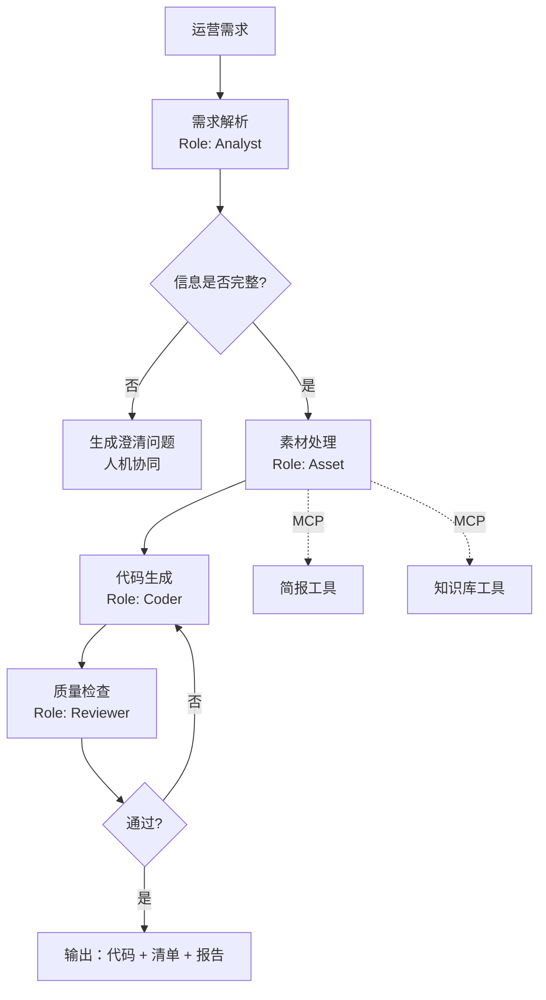

# Day 30 · M3 架构设计：Agentic 活动搭建助手

> W6 · 周五 ｜ 5h ｜ 产出 `docs/week-06/m3-design.md` ｜ [Day 29](day-29.md) ｜ **本周里程碑**

**今日目标**
- 把"AI Skill 活动搭建"的真实经验，设计成可演示的多智能体系统
- 完成架构设计文档：角色、状态、工具、失败处理、验收指标
- 明确"哪些环节必须人工"，这决定它能不能进真实业务流程

**验收**：设计文档可让另一个人照着实现；含架构图、状态机、角色契约、风险表、指标。

---

## 上午 09:00–11:30 · 设计

### 1. 业务背景（你的真实故事）

你在 4399 用 AI Skill 把活动页交付从 3 天压到 1 天。现在要把它产品化：

```text
输入：一句运营需求（"做一个情人节双人组队活动，奖励是限定皮肤"）
输出：
  - 活动页代码骨架（HTML/CSS/JS 或 Vue 组件）
  - 素材清单（需要哪些图、文案、配置项）
  - 自检报告（合规、埋点、响应式、可访问性）
  - 交付周期对比数据
```

**这个项目的说服力来自"你真的做过"**，不是来自技术复杂度。

### 2. 架构



四个角色（对应你 PDF 里写的）：需求解析、素材处理、代码生成、质量检查。

### 3. 角色契约

```python
class Requirement(BaseModel):
    title: str
    goal: str
    target_users: str
    mechanics: list[str]           # 玩法步骤
    rewards: list[str]
    constraints: list[str]         # 合规/技术限制
    missing: list[str]             # 缺失信息 → 触发澄清

class AssetPlan(BaseModel):
    images: list[dict]             # {name, size, purpose}
    copywriting: dict              # {headline, sub, rules, cta}
    configs: dict                  # 活动配置项
    data_needs: list[str]          # 需要的埋点

class CodeArtifact(BaseModel):
    files: list[dict]              # {path, content}
    entry: str
    notes: str

class ReviewReport(BaseModel):
    scores: dict[str, int]         # compliance / responsive / a11y / tracking
    issues: list[dict]             # {severity, file, line, message, fix}
    verdict: Literal["pass", "revise"]
```

**每个角色都有 Pydantic 契约**——这是从"Demo"到"系统"的关键。没有契约，多智能体就是四个 chatbot 聊天。

### 4. 状态机

```python
class M3State(TypedDict):
    requirement: Requirement
    assets: AssetPlan | None
    code: CodeArtifact | None
    review: ReviewReport | None
    round: int
    clarifications: list[str]
    timeline: list[dict]           # 每步耗时，用于交付周期对比
```

路由：

```text
analyst → (missing 非空) → clarify → 等待人工 → analyst
analyst → (完整) → asset → coder → reviewer → (pass) → finalize
                                        └→ (revise & round<2) → coder
```

### 5. 人工介入点（HITL）

| 环节 | 为什么必须人工 | 实现 |
| --- | --- | --- |
| 信息澄清 | 运营才知道"限定皮肤"具体指哪款 | `interrupt()` 等人回答 |
| 素材确认 | 图片版权、品牌规范 | 人工上传/确认 |
| 上线前 | 代码要过 CI、合规要过审 | 导出 PR，不自动部署 |

**明确"不自动做什么"，比"能自动做什么"更能体现工程成熟度。**

### 6. 指标与风险

| 指标 | 目标 | 测法 |
| --- | --- | --- |
| 端到端耗时 | ≤ 10 分钟 | 5 个真实需求计时 |
| 一次通过率（Reviewer pass） | ≥ 60% | 20 次生成 |
| 代码可运行率 | ≥ 90% | 打开即无报错 |
| 人工修改量 | ≤ 30% | diff 行数占比 |
| 单次成本 | ≤ 1 元 | token 统计 |

风险：生成代码有安全漏洞、素材版权、幻觉配置项、上下文超长、模型升级导致输出漂移。

---

## 下午 14:00–16:30 · 实战

### 任务 1 · 写设计文档（100 min）

`docs/week-06/m3-design.md`，包含：
1. 业务背景与目标（含"3 天 → 1 天"的原始数据）
2. 架构图（mermaid）
3. 角色契约（四个 Pydantic 模型）
4. 状态机与路由
5. HITL 介入点
6. 指标与测法
7. 风险与缓解
8. 里程碑拆解（Day 36 / 37 各做什么）

### 任务 2 · 技术选型表（30 min）

| 决策 | 选项 | 选择 | 理由 |
| --- | --- | --- | --- |
| 编排 | 手写 / LangGraph | LangGraph | 需要状态持久化与 HITL |
| 代码生成 | 单次 / 分文件 | 分文件 | 便于 Review 与 diff |
| 校验 | LLM 自检 / 规则 + LLM | 规则优先 | 便宜且确定 |
| 工具接入 | 直接调用 / MCP | MCP | 复用 M1/M2，且能对外提供 |
| 前端 | Vue / 纯 HTML | 纯 HTML 模板 | 生成物要能直接预览 |

### 任务 3 · 用 3 个真实需求"纸上推演"（40 min）

拿三个真实活动需求，手工走一遍状态机：
- 哪一步会缺信息？
- 代码生成需要哪些输入？
- Reviewer 能查出什么问题？
把推演结果写进文档——**这能提前暴露 80% 的设计缺陷**。

### 任务 4 · 预告明天（10 min）

列出 Day 36 要写的两个核心角色（analyst / coder）的输入输出示例各一条。

---

## 代码思考（写进 `logs/day-30.md`）

1. 为什么"角色契约"比"角色 prompt"更重要？没有契约会出什么问题？
2. 澄清环节如果运营一直不回复，系统应该怎样？（超时、默认值、还是阻塞）
3. 代码生成用"一次生成整页"还是"分文件生成"，对 Reviewer 和人工修改有什么影响？
4. 指标里"一次通过率 ≥ 60%"，如果只有 30%，你会先改 Reviewer 还是先改 Coder？
5. 如果模型升级后输出格式变了，你的契约层能挡住吗？怎么验证？

## 复盘清单（本周里程碑自检）

- [ ] 设计文档完整，别人能照着实现
- [ ] 四个角色契约定义清楚
- [ ] 3 个真实需求纸上推演过
- [ ] MCP Server 已可被 M3 复用
- [ ] commit：`M3 架构设计（四角色 + HITL + 指标）`
