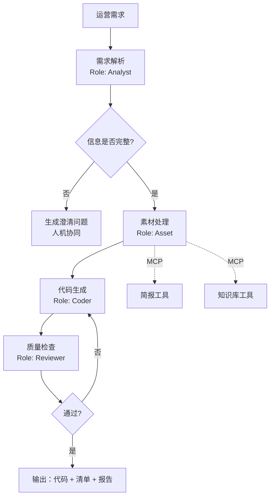

# M3 架构设计：Agentic 活动搭建助手

> W6 · Day 30 产出 ｜ 本周里程碑

## 1. 业务背景与目标

你在 4399 用 AI Skill 把活动页交付从 3 天压到 1 天。现在要把这套经验产品化：

```text
输入：一句运营需求（"做一个情人节双人组队活动，奖励是限定皮肤"）
输出：
  - 活动页代码骨架（HTML/CSS/JS 或 Vue 组件）
  - 素材清单（需要哪些图、文案、配置项）
  - 自检报告（合规、埋点、响应式、可访问性）
  - 交付周期对比数据
```

**项目说服力来自"你真的做过"，不是技术复杂度。**

## 2. 架构图



四个角色：需求解析、素材处理、代码生成、质量检查。

## 3. 角色契约

每个角色都有 Pydantic 契约——这是从"Demo"到"系统"的关键。

```python
from pydantic import BaseModel
from typing import Literal

class Requirement(BaseModel):
    title: str
    goal: str
    target_users: str
    mechanics: list[str]           # 玩法步骤
    rewards: list[str]
    constraints: list[str]         # 合规/技术限制
    missing: list[str]             # 缺失信息 → 触发澄清

class AssetPlan(BaseModel):
    images: list[dict]             # {name, size, purpose}
    copywriting: dict              # {headline, sub, rules, cta}
    configs: dict                  # 活动配置项
    data_needs: list[str]          # 需要的埋点

class CodeArtifact(BaseModel):
    files: list[dict]              # {path, content}
    entry: str
    notes: str

class ReviewReport(BaseModel):
    scores: dict[str, int]         # compliance / responsive / a11y / tracking
    issues: list[dict]             # {severity, file, line, message, fix}
    verdict: Literal["pass", "revise"]
```

**没有契约，多智能体就是四个 chatbot 聊天。**

## 4. 状态机与路由

```python
from typing import TypedDict

class M3State(TypedDict):
    requirement: Requirement
    assets: AssetPlan | None
    code: CodeArtifact | None
    review: ReviewReport | None
    round: int
    clarifications: list[str]
    timeline: list[dict]           # 每步耗时，用于交付周期对比
```

路由：

```text
analyst → (missing 非空) → clarify → 等待人工 → analyst
analyst → (完整) → asset → coder → reviewer → (pass) → finalize
                                        └→ (revise & round<2) → coder
```

## 5. HITL 介入点

| 环节 | 为什么必须人工 | 实现 |
| --- | --- | --- |
| 信息澄清 | 运营才知道"限定皮肤"具体指哪款 | `interrupt()` 等人回答 |
| 素材确认 | 图片版权、品牌规范 | 人工上传/确认 |
| 上线前 | 代码要过 CI、合规要过审 | 导出 PR，不自动部署 |

**明确"不自动做什么"，比"能自动做什么"更能体现工程成熟度。**

## 6. 指标与测法

| 指标 | 目标 | 测法 |
| --- | --- | --- |
| 端到端耗时 | ≤ 10 分钟 | 5 个真实需求计时 |
| 一次通过率（Reviewer pass） | ≥ 60% | 20 次生成 |
| 代码可运行率 | ≥ 90% | 打开即无报错 |
| 人工修改量 | ≤ 30% | diff 行数占比 |
| 单次成本 | ≤ 1 元 | token 统计 |

## 7. 风险与缓解

| 风险 | 缓解 |
| --- | --- |
| 生成代码有安全漏洞 | Reviewer 加安全扫描规则；人工上线前审 |
| 素材版权 | HITL 素材确认环节；只允许用授权素材库 |
| 幻觉配置项 | 配置项用 JSON Schema 校验；不在契约里的字段丢弃 |
| 上下文超长 | 分文件生成；Reviewer 只看 diff；素材摘要代替全文 |
| 模型升级导致输出漂移 | Pydantic 契约挡第一层；eval 集回归测试挡第二层 |

## 8. 技术选型

| 决策 | 选项 | 选择 | 理由 |
| --- | --- | --- | --- |
| 编排 | 手写 / LangGraph | LangGraph | 需要状态持久化与 HITL |
| 代码生成 | 单次 / 分文件 | 分文件 | 便于 Review 与 diff |
| 校验 | LLM 自检 / 规则 + LLM | 规则优先 | 便宜且确定 |
| 工具接入 | 直接调用 / MCP | MCP | 复用 M1/M2，且能对外提供 |
| 前端 | Vue / 纯 HTML | 纯 HTML 模板 | 生成物要能直接预览 |

## 9. 里程碑拆解

| 里程碑 | 内容 | 产出 |
| --- | --- | --- |
| Day 36 | 实现 Analyst + Coder 两个核心角色 | `code/week08/activity_assistant/` |
| Day 37 | 接入 Asset + Reviewer，跑通完整流水线 | 四角色协作 + HITL |
| Day 38 | 接 MCP 工具（M1 简报 + M2 知识库） | 工具复用演示 |
| Day 39 | 评估与调优 | 一次通过率、成本、延迟报告 |
| Day 40 | 毕业项目收尾 | README + 演示视频 |

## 10. 纸上推演（3 个真实需求）

### 需求 A："做一个情人节双人组队活动，奖励是限定皮肤"

- **Analyst 缺什么？** "限定皮肤"具体指哪款、活动持续几天、是否有等级门槛
- **Asset 需要什么？** 情人节主题背景图、双人组队玩法示意图、皮肤展示图
- **Coder 输入**：Requirement + AssetPlan → 输出 HTML 骨架（活动规则页 + 组队页面）
- **Reviewer 能查出什么？** 组队规则描述是否清晰、奖励发放条件是否完整、埋点是否覆盖关键路径

### 需求 B："做一个新手引导活动，连续登录 7 天送金币"

- **Analyst 缺什么？** 金币数量、是否有递进奖励、活动针对新用户还是回流用户
- **Asset 需要什么？** 金币图标、登录日历 UI、奖励领取按钮
- **Coder 输入**：需求清晰，直接生成
- **Reviewer 能查出什么？** 连续登录逻辑是否处理断签、金币发放是否有上限

### 需求 C："做一个周年庆抽奖活动，奖品包括 iPhone 和周边"

- **Analyst 缺什么？** 抽奖概率、奖品库存、是否需要实名认证
- **Asset 需要什么？** 奖品展示图、抽奖动画、中奖名单滚动
- **Coder 输入**：需要 Asset 确认后才能生成（涉及奖品图片版权）
- **Reviewer 能查出什么？** 抽奖概率是否公示、合规文案是否齐全

**推演结论**：80% 的需求会在 Analyst 环节触发至少一次澄清；Asset 环节的版权确认是硬卡点；Reviewer 对"合规"和"埋点"的检查最有效。

---

> 设计文档完成。M3 将在 Day 36-40 按本设计实现。
